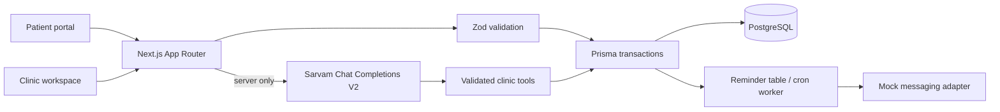

# Carebridge Health Agent

A clinic coordination workspace built with Next.js App Router, TypeScript, PostgreSQL, Prisma, NextAuth, and Zod. It includes a patient portal, staff dashboard, appointment scheduling, intake, campaigns, insurance workflows, and a Sarvam-powered assistant.

## Start locally

1. Install Node.js 20+ and pnpm 9+.
2. Copy `.env.example` to `.env` and fill the local values. Keep `SARVAM_API_KEY` server-side.
3. Run `pnpm quickstart` to start PostgreSQL, install packages, apply the schema, seed synthetic clinic data, and start the website. For later runs use `pnpm dev`.
5. Visit `http://localhost:3000`. Seed login: `admin@carebridge.local` / `ChangeMe-Local-2026!` (change immediately outside local development).

Run `pnpm typecheck`, `pnpm lint`, `pnpm test`, `pnpm test:e2e`, and `pnpm build` before deployment. The app uses Asia/Kolkata for appointment display and stores timestamps in UTC.

## Structure

```text
src/app/             Landing, staff pages, patient portal, API routes
src/components/      Accessible navigation, forms, and assistant UI
src/lib/             Prisma, authorization, encryption, agent tools, reminders
prisma/schema.prisma PostgreSQL data model and constraints
prisma/seed.ts       Synthetic local clinic setup
tests/               Unit and browser tests
```



## Integrations

Sarvam credentials are read only by `/api/agent`. The assistant can call clinic tools, but those tools validate arguments and read or mutate clinic records; the model never supplies availability or insurer truth. The insurer, email, SMS, and WhatsApp integrations are currently mock adapters. Replace `src/lib/reminder-worker.ts` with a provider implementation and retain the database idempotency keys and opt-out checks before enabling delivery. For insurance, implement a separate adapter that maps verified insurer responses into the existing eligibility, pre-auth, and claim models.

Sensitive intake answers use AES-256-GCM through `PHI_ENCRYPTION_KEY`; use a managed KMS and rotation strategy before production. Audit events must be retained and access limited by role. The seed credentials are local only. The demo UI contains synthetic sample rows and no real patient records.

## Safety and limitations

- This is a starter implementation, not a certification or legal compliance determination. Review DPDP Act 2023, ABDM requirements, applicable health-record rules, contracts, retention, consent, and security controls with qualified counsel and security teams before real patient use.
- The AI assistant is disclosed, avoids diagnosis and treatment advice, escalates emergency keywords to 108/112, and uses server-side tools for appointment and insurance facts.
- Reminder processing is a cron-friendly database worker (`pnpm reminders:run`); configure a scheduler and real provider with delivery receipts, retries, and opt-out enforcement before sending.
- Clinic integrations and insurer responses are mocked; no messages are sent externally.
- Add production rate limiting, managed secrets, KMS, object storage malware scanning, monitoring, backup/recovery, and a full authorization review before go-live.
